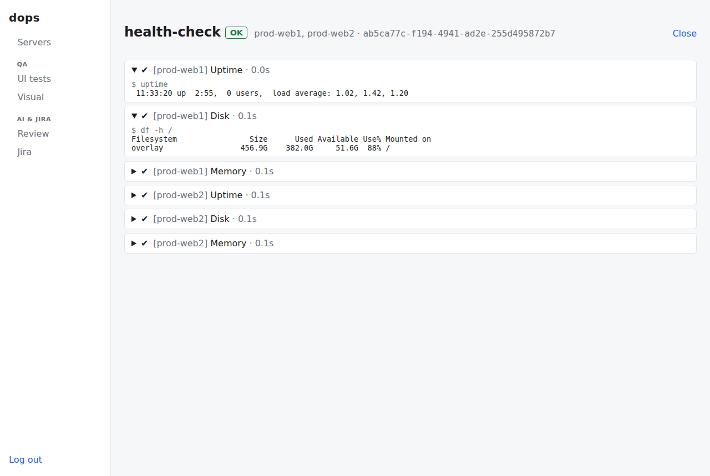
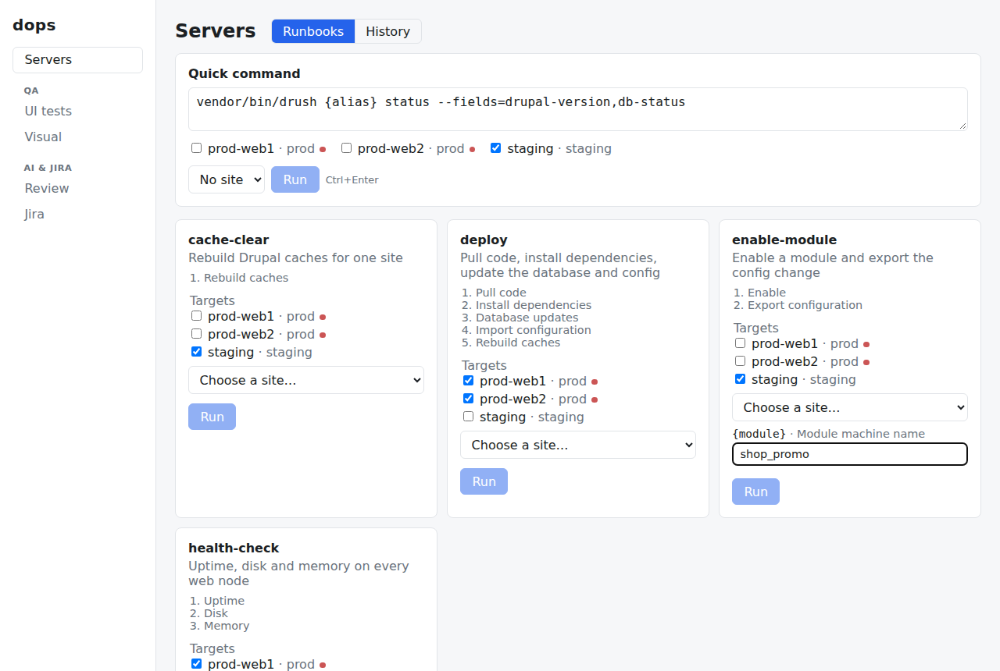
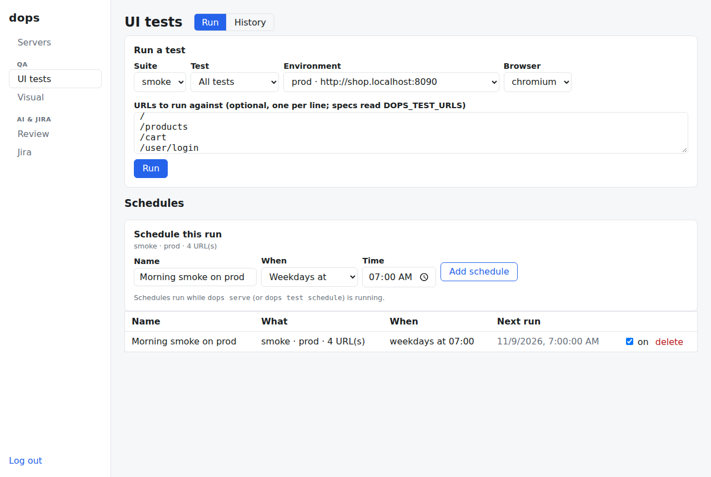
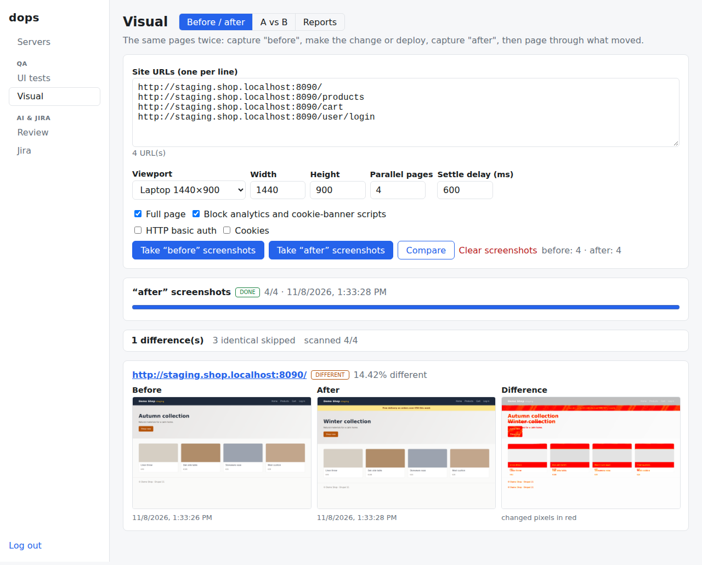
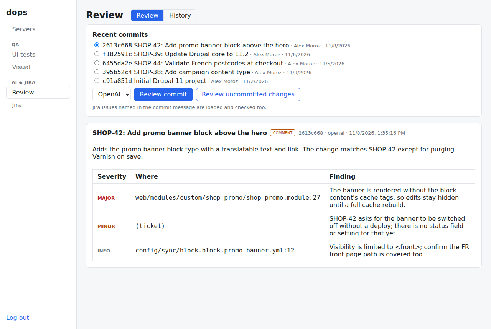
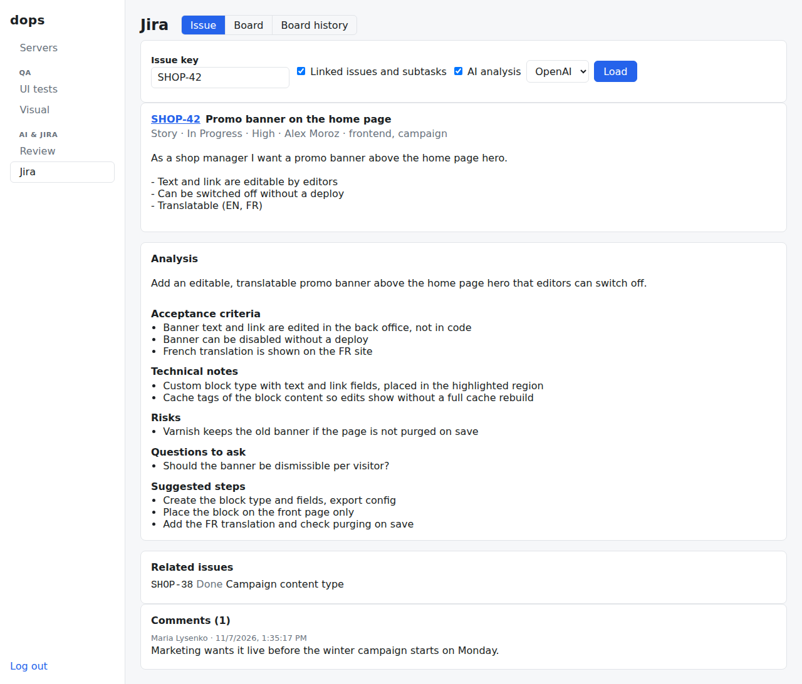
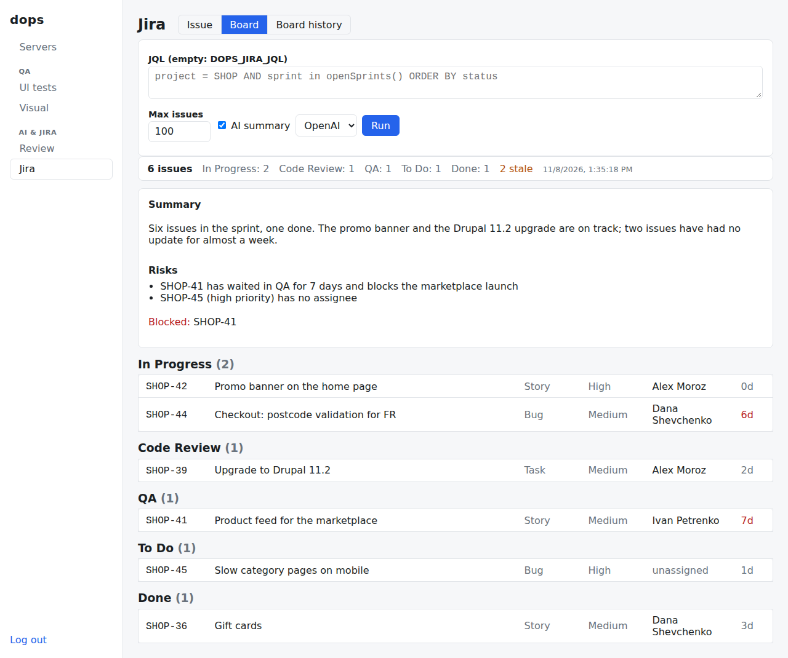
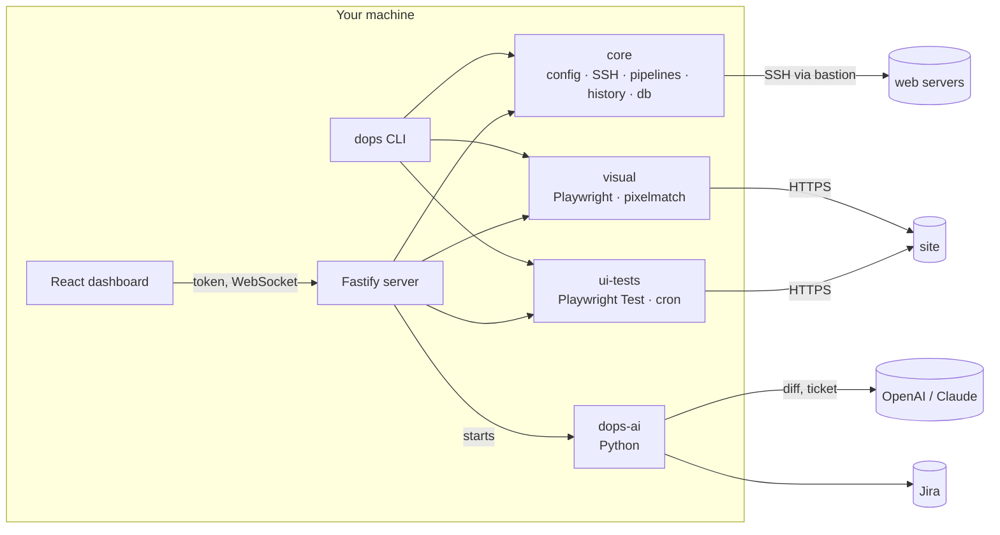

# drupal-ops-toolkit

[](https://github.com/dimidjy/drupal-ops-toolkit/actions/workflows/ci.yml)

The tools I built to automate the repetitive parts of my Drupal work: deploys
and runbooks over SSH, database pulls, visual regression checks, Playwright UI
tests, and AI review checked against the Jira ticket. One `dops` CLI, a
localhost dashboard on top of it, and one YAML config per project. Secrets
never live in that config.



## What it does

- **Runbooks over SSH**: named lists of shell steps run on one or more
  servers through a bastion, with live output and a history of every run.
  Values per site for multisites, parameters asked for at run time, one-off
  commands on ticked servers, and local (DDEV) routines that work the same way.
- **Production guard**: production servers are never touched by accident. The
  CLI wants `--yes`, the dashboard asks first and the API refuses without an
  explicit confirmation.
- **Database pulls**: a gzipped `drush sql-dump` streamed through the bastion
  into a local file, and imported into the DDEV site if you like.
- **Visual regression**: screenshot a list of pages before and after a
  release and page through what changed, or compare two environments (or two
  URL lists) side by side.
- **UI tests**: Playwright suites or single specs against any environment, in
  Chromium, Firefox, WebKit or a phone emulation, on demand or on a schedule,
  with reports and a webhook when something breaks.
- **AI and Jira**: LLM review of a diff or a commit, checked against its Jira
  ticket and usable as a pre-push hook; an analysis of a ticket before
  starting it; a sprint overview for stand-up.
- **Claude Code plugin**: skills for the ticket workflow around all of the
  above.

## Quick start

Requires Node.js 22 (see `.nvmrc`), and Python 3.12 with
[uv](https://docs.astral.sh/uv/) for the AI part.

```bash
npm install
npx playwright install chromium                     # visual checks and UI tests
cp examples/dops.config.example.yml dops.config.yml # targets, pipelines, URL sets, suites
cp .env.example .env                                # values the config refers to

npx dops check                                      # validates everything, connects nowhere
npx dops --help
```

## A typical release

```bash
npx dops test run smoke                       # is staging healthy?
npx dops visual capture staging --label before
uv run dops-ai review --diff main...          # last look at the branch
npx dops run deploy --yes                     # pull, composer, updb, cim, cr on both web nodes
npx dops visual capture staging --label after
npx dops visual compare staging               # anything that moved?
```

## Runbooks and servers

```bash
npx dops check                        # config, env file, SSH keys, variables: no connection
npx dops targets                      # servers by environment, production marked
npx dops pipelines                    # what can I run?
npx dops sites                        # sites and the values they fill in
npx dops run cache-clear --dry-run    # the commands per target, without connecting
npx dops run deploy                   # run it, with live output
npx dops exec -t prod-web1 prod-web2 -- drush status   # one-off command
npx dops history                      # previous runs
npx dops history show <run-id>        # steps and full output of one run
```

A pipeline is a list of shell steps that runs on one or more targets, through
a bastion when needed. A failing step stops the run and the remaining targets
are skipped, so a broken release never reaches every server. `dops deploy` is
another name for `dops run`.

Steps can use `{placeholders}`: values of the target (`{target}`, `{path}`),
of a site (`{alias}`, picked with `--site`) and parameters declared under
`params` with a description and an optional default. Missing values are asked
for before anything runs: as fields in the dashboard, or with
`-p branch=release/2.4` on the command line.

A target with `local: true` runs its steps in a shell on this machine, inside
its `path`. That's handy for routines like `ddev drush cim` after switching
branches, with the same history and output as remote runs. SSH uses your key
file or agent; no passwords are stored in the config.

### Production guard

Targets marked `production: true` (or listed in an environment file with
`production: true`) never run by accident. `dops run`, `dops exec` and
`dops db pull` refuse them without `--yes`, while `--dry-run` always works. The
dashboard marks them and asks for confirmation, and the API answers 428 unless
the request carries `confirmProduction: true`.

### Pipelines and environments as files

Next to `dops.config.yml`, pipelines and environments can live one per file,
which is easier to edit (or to have an assistant generate) than one big file:

```text
dops.config.yml          sites, params, visual, tests…
environments/
  local.yml              targets: { laptop: { local: true, … } }
  staging.yml            bastions and targets of staging
  prod.yml               production: true marks all its targets
pipelines/
  deploy.yml             description, environment: prod, steps
  cache-clear.yml
```

Every target in `environments/<env>.yml` gets `environment: <env>`. A pipeline
file can name an `environment` instead of `targets` and then runs on all of its
targets. The file name is the pipeline name, and a name defined twice is an
error. Both folders are gitignored here; start from
[examples/environments](examples/environments) and
[examples/pipelines](examples/pipelines).

### Command-line conventions

Short options mean the same everywhere: `-t` target, `-s` site, `-p` value for
a `{placeholder}` (port for `serve`), `-e` environment, `-n` dry run, `-y`
confirm production, `-l` limit and `-c` config file. A few belong to one
command: `-o` output file and `-i` import for `db pull`, and `-f` spec file,
`-b` browser, `-u` URL and `-q` quiet for `test run`. Everything else is a long
option, such as `--label`, `--path`, `--force` or `--suite`.

`check`, `targets`, `pipelines`, `history`, `test history` and
`visual compare` print JSON with `--json`, for scripts and assistants.
`dops check` and failed runs exit with 1.

## Database

```bash
npx dops db pull prod-web1 --site fr --yes   # .dops/db/prod-web1-fr-<time>.sql.gz
npx dops db pull staging --import            # and load it into the local DDEV site
```

The dump runs `db.dumpCommand` on the target (by default `drush sql-dump`
without cache, flood, session and watchdog data, gzipped) and streams it
through the bastion straight into a local file. The file is only kept if the
command succeeded and the output really is gzip.

## Dashboard

```bash
npm run build      # builds the React dashboard once
npx dops serve     # http://127.0.0.1:4800
```

The dashboard is hands-on access next to CI/CD, not a replacement for it.
Every section has a title and a switch between its tabs:

- **Servers** (Runbooks, History): the pipelines of the config as runbooks
  that start on chosen targets and sites and stream their output live, plus a
  quick-command box for one-off commands such as `drush status` on the ticked
  servers. Local targets are left to the CLI.
- **UI tests** (Run, History): run a suite or one spec against any of its
  environments and browsers, and schedule that run.
- **Visual** (Before / after, A vs B, Reports): capture pasted URL lists
  without any config, and open the reports written by the CLI.
- **Review** (Review, History): AI review of a recent commit or of the
  uncommitted changes.
- **Jira** (Issue, Board, Board history): an issue with an AI analysis, and
  sprint overviews.

| Runbooks and quick command                     | UI tests and schedules                  |
| ---------------------------------------------- | --------------------------------------- |
|       |  |
| **Visual before / after**                      | **AI review of a commit**               |
|  |   |
| **Jira issue with AI analysis**                | **Sprint board with stand-up summary**  |
|              |     |

It only listens on localhost, and every API call needs a token (`DOPS_TOKEN`,
or the one printed on start). Listening on another interface requires
`DOPS_ALLOW_REMOTE=1`. Pipelines and parameters are edited as files, not in
the dashboard.

## Visual checks

Screenshot a list of pages before a release, again after it, and get a pixel
diff with an HTML report:

```bash
npx dops visual capture staging --label before
npx dops run deploy --yes
npx dops visual capture staging --label after
npx dops visual compare staging    # exit code 1 when pages differ, 2 when pages are broken
```

The report (`.dops/visual/<set>/report-before-after.html`) lists changed pages
first, with before, after and diff images side by side. Dynamic elements such
as status messages or sliders can be hidden with `visual.hide` selectors, and
`visual.cacheBust: true` adds a unique query parameter so Varnish or a CDN
serves fresh pages. Pages are captured in parallel browser tabs
(`visual.concurrency`, default 4). `--path /events` adds pages for one run, and
`--like before` captures exactly the pages of an earlier capture.

A capture only goes where the URL set points. Every redirect hop is checked
before the browser requests it, and a hop to another origin is blocked (list
extra ones in `allowedOrigins`), so a misconfigured environment can't send the
capture or its credentials to another site. Environments behind basic auth
read their credentials from the env variables named in `httpAuth`. Pages that
answer 4xx/5xx, get blocked or show a Drupal or PHP error page are marked
broken, and `compare` fails for them even when the baseline was just as broken.
A label is never overwritten without `--force`, and the old capture is only
replaced once the new one has finished.

The dashboard's Before / after tab does the same without any config: paste a
list of URLs, pick a viewport and settle delay, optionally add basic auth or
cookies (used for that capture only), take the "before" screenshots, deploy,
take the "after" ones and compare.

### Comparing two environments

A URL set can list other deployments of the same site. `ab` captures two of
them in parallel and diffs them, which is handy for checking that staging still
looks like production before a release:

```yaml
visual:
  urlSets:
    staging:
      baseUrl: https://staging.example.com
      paths: [/, /products, /cart]
      environments:
        prod: https://www.example.com
        stage: https://staging.example.com
```

```bash
npx dops visual ab staging prod stage     # report-prod-stage.html
npx dops visual capture staging --env prod
```

For pages that live under different URLs (an old and a new URL scheme, or two
different sites), the dashboard's A vs B tab takes two URL lists paired line by
line, each side with its own basic auth and cookies, and diffs every pair.

## UI tests

Playwright suites are plain `*.spec.js` folders listed in the config. dops
generates the Playwright config for each run (base URL, retries, basic auth
from the environment) and keeps every run's HTML report and traces.

```bash
npx dops test list
npx dops test run smoke             # counts, failing tests, report path
npx dops test run smoke --file pages.spec.js --env prod --browser mobile --url / --url /cart
npx dops test history
npx dops test show <run-id>
npx dops test schedule              # keep running and start suites on their schedules
```

Specs get the URL list in `DOPS_TEST_URLS` (see
[examples/ui-tests/smoke/pages.spec.js](examples/ui-tests/smoke/pages.spec.js)).
Schedules come from `uiTests.schedules` in the config or from the dashboard
("weekdays at 07:00", "every 30 minutes" or any cron) and run inside
`dops serve` or `dops test schedule`. With `uiTests.notify`, failing runs (and
recoveries) are posted to a Slack-compatible webhook.

[examples/ui-tests/smoke](examples/ui-tests/smoke) checks a Drupal site: home
page without PHP or JavaScript errors, the login form, JSON:API.

## AI review and Jira

`python/ai-review` is a small Python CLI, `dops-ai`, that I use around every
merge request. It works with OpenAI or Claude.

```bash
cd python/ai-review && uv sync
uv run dops-ai review --diff main... --provider anthropic   # the whole branch
uv run dops-ai commit                    # HEAD, checked against the Jira tickets in its message
uv run dops-ai issue SHOP-42 --analyze   # criteria, risks, questions and steps before starting
uv run dops-ai board --summarize         # the sprint by status, idle issues, stand-up summary
uv run dops-ai report --days 7           # my week as markdown with links
uv run dops-ai hook install              # review before every git push
```

- The review has to match a JSON schema (a verdict, plus findings with file,
  line and severity), so it can gate a push instead of being chat text. Lock
  files and minified assets are left out, and large diffs are trimmed by whole
  files.
- `commit` loads the tickets named in the commit message and reports
  requirements that the change doesn't cover as findings.
- The model only sees the diff and the ticket text. It can't run anything:
  deploys, database pulls and tests are plain code paths.

The dashboard's Review and Jira sections call the same CLI and keep past
reviews and board reports. See
[python/ai-review/README.md](python/ai-review/README.md) for every option and
variable.

I also pair with an AI coding assistant while writing this code, for
scaffolding, tests and refactors, and I review every change myself. The tests,
strict `tsc --checkJs`, mypy and CI are what make that safe.

## Configuration and secrets

Everything lives in `dops.config.yml` (see
[examples/dops.config.example.yml](examples/dops.config.example.yml)). Secrets
never go in that file: SSH uses keys or the agent, and passwords, tokens and
webhook URLs are read from environment variables.

Each project keeps them in one env file outside any repository, named by
`envFile` in the config (for example `~/.config/dops/shop.env`, see
[.env.example](.env.example)). Every command reads it before resolving
`${VAR}`, the dashboard passes it on to the `dops-ai` processes it starts, and
the Claude Code plugin points at the same file. Shell variables win, then
`DOPS_ENV_FILE`, then `envFile`, then a `.env` next to the config. Run on its
own, `dops-ai` only sees the shell, so load the file there first
(`set -a; . ~/.config/dops/shop.env; set +a`).

## Architecture



| Package             | What it does                                                                       |
| ------------------- | ---------------------------------------------------------------------------------- |
| `packages/core`     | Config (YAML + zod), checks, SSH and local executors, pipeline runner, history, DB |
| `packages/cli`      | The `dops` command (commander)                                                     |
| `packages/server`   | Fastify API and WebSocket live logs, background jobs, localhost only, token        |
| `packages/web`      | Dashboard (React 19 + Vite)                                                        |
| `packages/visual`   | Screenshots, pixel diff, HTML report, A/B mode, URL-list workspace, page compare   |
| `packages/ui-tests` | Playwright suites, single specs, browsers, history, schedules, webhook             |
| `python/ai-review`  | `dops-ai`: review, commit vs ticket, issue analysis, board, report, hook           |

The Node code is plain JavaScript (ES modules) with JSDoc types checked by
`tsc --checkJs` in strict mode, so there's no build step outside the dashboard.

## Claude Code plugin

`claude/` is a Claude Code plugin (`dops`), and this repository is its
marketplace. Its skills cover the ticket workflow around the tools above:
ticket history and Jira, deploy branch preparation, pipeline files, visual QA
with `dops visual`, test content on non-production environments, and
chat-ready reports. Project values live in a profile file inside the project,
never in this repository.

```bash
claude plugin marketplace add ./drupal-ops-toolkit
claude plugin install dops@drupal-ops-toolkit --scope local
```

See [claude/README.md](claude/README.md).

## Development

```bash
npm run check              # eslint + tsc --checkJs + vitest
npm run format:check
npm run build              # dashboard
npm run test:integration   # Docker: a real sshd bastion and target, pipeline and dump through the tunnel

cd python/ai-review
uv run ruff check && uv run ruff format --check && uv run mypy && uv run pytest
```

CI runs the Node checks, the Python checks and the integration test on every
push.

## Contact

Questions, ideas or collaboration: Telegram [@dimidjy](https://t.me/dimidjy).

## License

[MIT](LICENSE)
