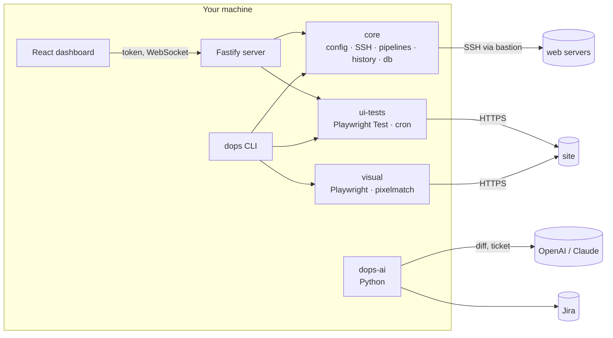
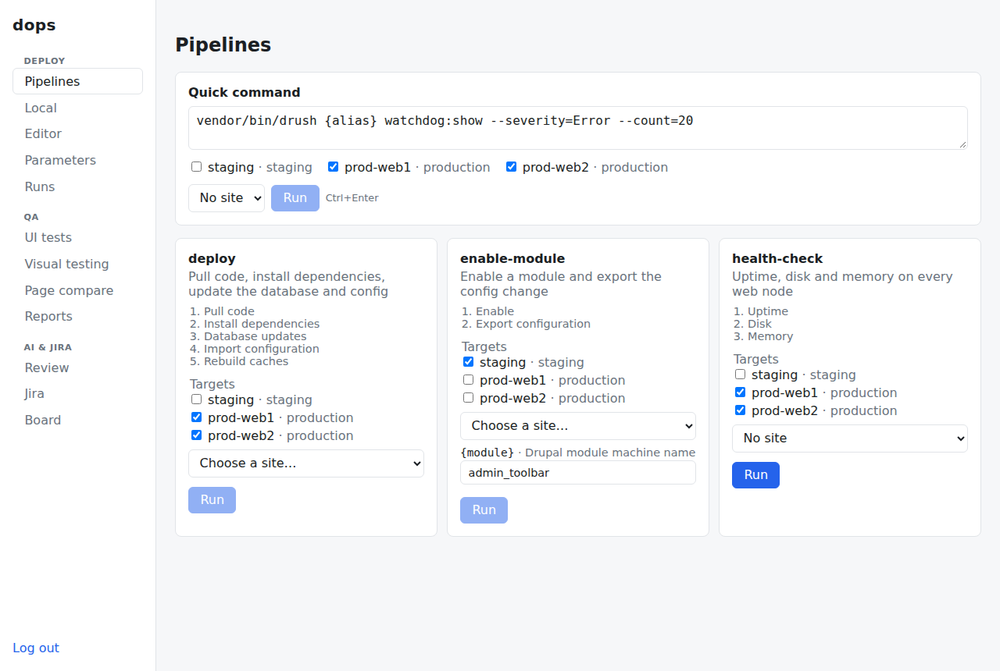

# drupal-ops-toolkit

[](https://github.com/dimidjy/drupal-ops-toolkit/actions/workflows/ci.yml)

The tools I built to automate the repetitive parts of my Drupal work. It is a
Node.js monorepo with a small Python package for the AI parts:

- **Deploy pipelines over SSH**: named lists of shell steps run on one or more
  servers, through a bastion, with live output, per-site values for
  multisites, parameters asked for at run time and a history of every run;
  quick one-off commands and local (DDEV) routines work the same way
- **Pipeline editor**: build and edit pipelines in the browser from Drupal
  templates, next to the ones in the config file
- **Database pulls**: a gzipped `drush sql-dump` streamed through the bastion
  and imported into the local DDEV site
- **Visual regression**: paste a list of URLs, screenshot them before and
  after a release (basic auth, cookies, viewport, parallel tabs) and page
  through what changed; compare two URL lists side by side, or staging next to
  production from the config
- **UI tests**: Playwright suites or single specs against any environment,
  in Chromium, Firefox, WebKit or a phone emulation, on demand or on a
  schedule, with history, reports and a webhook when something breaks
- **AI and Jira**: LLM review of a diff or a commit, checked against the Jira
  ticket, as a pre-push hook; an analysis of a ticket before starting it; a
  sprint summary for stand-up
- **Dashboard**: a localhost React UI over all of the above

Everything is driven by one YAML config. Secrets never live in it.

## A typical release

```bash
npx dops test run smoke                    # is staging healthy?
npx dops visual capture shop --label before
uv run dops-ai review --diff main...       # last look at the branch
npx dops deploy deploy                     # pull, composer, updb, cim, cr on both web nodes
npx dops visual capture shop --label after
npx dops visual compare shop               # anything that moved?
```

## AI in my workflow

I use AI in two places: while writing code, and as a step in this toolkit.

- **Writing code**: I pair with an AI coding assistant for scaffolding, tests
  and refactors, and I review every change myself. The tests, strict
  `tsc --checkJs`, mypy and CI are what make that safe.
- **Review before a merge request**: `dops-ai review --diff main...` sends the
  branch diff to OpenAI or Claude. The answer has to match a JSON schema
  (verdict, plus findings with file, line and severity), so it can gate a push
  instead of being chat text. Lock files and minified assets are left out, and
  large diffs are trimmed by whole files.
- **Did I build what the ticket asked for?** `dops-ai commit` reads the Jira
  key from the commit message, loads the ticket, and asks the model to list
  requirements that are missing as findings.
- **Before starting a ticket**: `dops-ai issue SHOP-42 --analyze` reads the
  issue, its comments and linked issues and drafts acceptance criteria, risks,
  open questions and the order of work.
- **Stand-up and weekly notes**: `dops-ai board --summarize` groups the sprint
  by status, highlights issues that have been idle for days, and lets the model
  write a short summary with risks. `dops-ai report` turns my week into
  markdown with links.

All of it is also in the dashboard (Review, Jira and Board), which calls the
same CLI. The model only ever sees the diff and the ticket text. It cannot run
anything: deploys, database pulls and tests are plain code paths.

## Architecture



| Package             | What it does                                                                       |
| ------------------- | ---------------------------------------------------------------------------------- |
| `packages/core`     | Config (YAML + zod), SSH and local executors, pipeline runner, params, history, DB |
| `packages/cli`      | `dops` command (commander)                                                         |
| `packages/server`   | Fastify API + WebSocket live logs, background jobs, localhost only, token          |
| `packages/web`      | Dashboard (React 19 + Vite)                                                        |
| `packages/visual`   | Screenshots, pixel diff, HTML report, A/B mode, URL-list workspace, page compare   |
| `packages/ui-tests` | Playwright suites, single specs, browsers, history, schedules, webhook             |
| `python/ai-review`  | `dops-ai`: review, commit vs ticket, issue analysis, hook, board (uv, typer)       |

The Node code is plain JavaScript (ES modules) with JSDoc types checked by
`tsc --checkJs` in strict mode, so there's no build step outside the dashboard.

## Quick start

Requires Node.js 22 (`.nvmrc`), and for the AI part Python 3.12 with
[uv](https://docs.astral.sh/uv/).

```bash
npm install
npx playwright install chromium                     # for visual checks and UI tests
cp examples/dops.config.example.yml dops.config.yml # targets, pipelines, URL sets, suites
cp .env.example .env                                # values referenced from the config

npx dops --help
```

## Deploy pipelines

```bash
npx dops pipelines                    # what can I run?
npx dops deploy cache-clear --dry-run # show the commands per target
npx dops deploy deploy                # run it, with live output
npx dops exec -t prod-web1 prod-web2 -- drush status   # one-off command
npx dops history                      # previous runs
npx dops history show <run-id>        # steps and full output of one run
```

Pipelines are lists of shell steps that run on one or more targets, through
a bastion when needed. A failing step stops the run; later targets are
skipped so a broken release never reaches every server.

SSH uses your key file or agent. No passwords are stored in the config.

Steps can use `{placeholders}`: target values (`{target}`, `{path}`), site
values (`{alias}`) and parameters declared under `params` with a description
and an optional default. Missing values are asked for before anything runs,
as fields in the dashboard or with `-p branch=release/2.4` in the CLI.

A target with `local: true` runs its steps in a shell on this machine, in its
`path`. That's handy for local routines like `ddev drush cim` after switching
branches, with the same history and live output as remote runs.

## Database

```bash
npx dops db pull prod --site fr            # .dops/db/prod-fr-<time>.sql.gz
npx dops db pull staging --import          # and load it into the local DDEV site
```

The dump runs `db.dumpCommand` on the target (by default `drush sql-dump`
without cache, session and watchdog data, gzipped) and streams it through the
bastion straight into a local file. The file is only kept if the command
succeeded and the output really is gzip.

## Dashboard


```bash
npm run build                 # builds the React dashboard once
npx dops serve                # http://127.0.0.1:4800
```

The dashboard lists pipelines, starts runs on chosen targets and sites,
streams their output live and keeps the run history. A quick-command box runs
any one-off command (`drush status`, `tail -n 50 …/php-error.log`) on the
ticked servers, and the Local tab does the same on this machine. It only listens on
localhost and every API call needs a token (`DOPS_TOKEN`, or the one printed
on start). Exposing it on another interface requires `DOPS_ALLOW_REMOTE=1`.
The sidebar groups everything: Deploy (pipelines, local, editor,
parameters, runs), QA (UI tests, visual testing, page compare, reports) and
AI & Jira (review, Jira, board).

| Pipelines and quick command               | Visual testing                                 |
| ----------------------------------------- | ---------------------------------------------- |
|  |  |
| **UI tests and schedules**                | **Jira issue with AI analysis**                |
|    |              |

Pipelines and parameters can also be created in the dashboard (Editor and
Parameters tabs) from templates such as "Drupal deploy" or "Deploy with
maintenance". They are saved to `.dops/workspace.json` (`dashboard.workspaceFile`)
and work from the CLI too; the ones in `dops.config.yml` stay read-only and
can be duplicated.

## Visual checks

Screenshot a list of pages before a release, again after it, and get a pixel
diff with an HTML report:

```bash
npx dops visual capture staging --label before
npx dops deploy deploy
npx dops visual capture staging --label after
npx dops visual compare staging      # exit code 1 when pages differ
```

The report (`.dops/visual/<set>/report-before-after.html`) shows changed pages
first with before, after and diff images side by side. Dynamic elements such
as status messages or sliders can be hidden with `visual.hide` selectors.
Environments behind basic auth read their credentials from the env variables
named in `httpAuth`.

The dashboard's Visual tab does the same without any config: paste a list of
URLs, pick a viewport and settle delay, optionally add basic auth or cookies
(used for that capture only), then take the "before" screenshots, deploy, take
the "after" ones and compare. Only the pages that changed are listed, with
before, after and diff images, twenty at a time.

### A/B: compare two environments

A URL set can list other deployments of the same site. `ab` captures two of
them in parallel and diffs them, which is handy for checking that staging still
looks like production before a release:

```yaml
visual:
  urlSets:
    shop:
      baseUrl: https://staging.example.com
      paths: [/, /products, /cart]
      environments:
        prod: https://www.example.com
        stage: https://staging.example.com
```

```bash
npx dops visual ab shop prod stage    # report-prod-stage.html
npx dops visual capture shop --env prod
```

Pages are captured in parallel browser tabs (`visual.concurrency`, default 4).

For pages that live under different URLs (an old and a new URL scheme, or two
different sites), the dashboard's Compare tab takes two URL lists paired line
by line, each side with its own basic auth and cookies, and diffs every pair.

## UI tests

Playwright suites are plain `*.spec.js` folders listed in the config; dops
generates the Playwright config per run (base URL, retries, basic auth from
env) and keeps every run's HTML report and traces.

```bash
npx dops test run smoke             # counts, failing tests, report path
npx dops test history
npx dops test show <run-id>
npx dops test schedule              # run suites on uiTests.schedules (cron)
```

From the dashboard's UI tests section you can run a whole suite or one spec
file, against the default URL or one of the suite's `environments`, in
Chromium, Firefox, WebKit or an emulated phone, and hand the specs a list of
URLs (they read `DOPS_TEST_URLS`; see `examples/ui-tests/smoke/pages.spec.js`).
Running tests can be stopped. Schedules ("weekdays at 07:00", "every 30
minutes" or any cron) are created there too and run inside `dops serve`, next
to the ones from the config file. The CLI takes the same options:
`dops test run smoke --file pages.spec.js --env prod --browser mobile --url / --url /cart`.

`examples/ui-tests/smoke` checks the demo site: home page without PHP or JS
errors, login form, JSON:API. With `uiTests.notify` failing runs (and
recoveries) are posted to a Slack-compatible webhook.

## Configuration and secrets

Everything lives in `dops.config.yml` (see
[examples/dops.config.example.yml](examples/dops.config.example.yml)). Secrets
never go in that file: SSH uses keys or the agent, and passwords, tokens and
webhook URLs are read from environment variables, optionally from a `.env`
file (see [.env.example](.env.example); shell variables win).

## AI review

`python/ai-review` is a small Python CLI (`dops-ai`) that I use around every
merge request:

- `dops-ai review --diff main...` sends the branch diff to OpenAI or Claude and
  gets back a structured review (verdict, findings with file, line and severity)
- `dops-ai commit` checks a commit against the Jira tickets named in its message
- `dops-ai hook install` runs the review before each `git push`
- `dops-ai board --summarize` gives a stand-up overview of the sprint

```bash
cd python/ai-review && uv sync
uv run dops-ai review --diff main... --provider anthropic
```

The dashboard's Review tab lists the latest commits of `ai.repo`; pick one and
it runs `dops-ai commit` (with the Jira tickets from the message) or reviews
the uncommitted changes, shows the findings and keeps past reviews.

The Jira tab loads an issue with comments and linked issues and can add an AI
analysis (acceptance criteria, risks, questions, steps); the Board tab runs
`dops-ai board` for a JQL query, with an optional stand-up summary, and keeps
the reports.

See [python/ai-review/README.md](python/ai-review/README.md).

## Development

```bash
npm run check              # eslint + tsc --checkJs + vitest
npm run format:check
npm run build              # dashboard
npm run test:integration   # Docker: real sshd bastion + target, pipeline and dump through the tunnel

cd python/ai-review
uv run ruff check && uv run mypy && uv run pytest
```

CI runs all three on every push.

## Contact

Questions, ideas or collaboration: Telegram [@dimidjy](https://t.me/dimidjy).

## License

[MIT](LICENSE)
